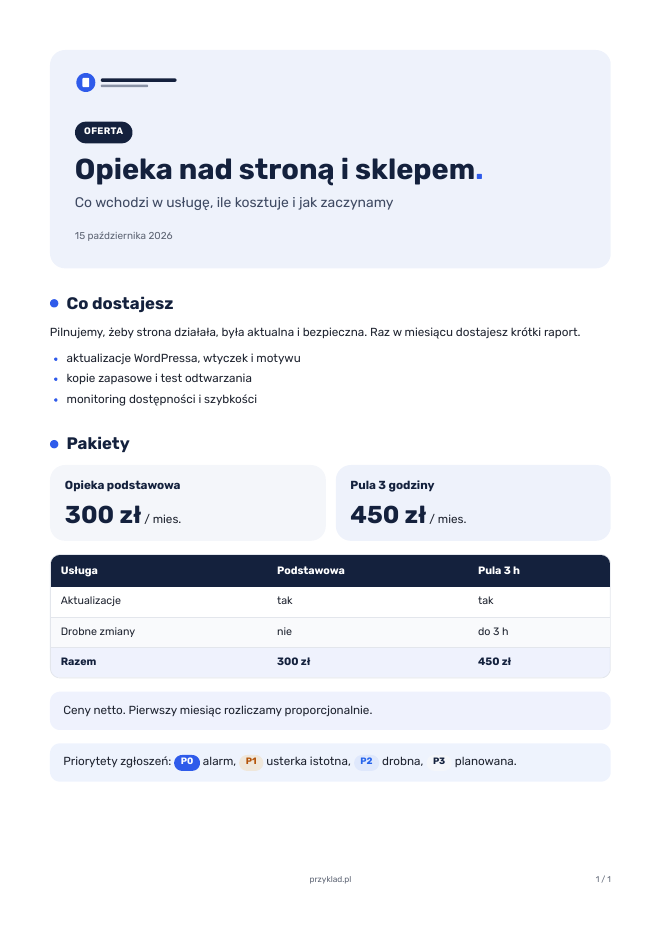

# papier-firmowy

Skill dla Claude Code (i innych agentów czytających `SKILL.md`), który zamienia Markdown w PDF na papierze firmowym: logo, font, kolory i dane prawne Twojej firmy. Oferta, umowa, list, instrukcja ze zrzutami ekranu wychodzą z tym samym układem strony, a agent przed każdym PDF-em pyta, dla jakiej firmy jest dokument.



## Co dostajesz

- 4 typy dokumentu: `dokument` (oferta, raport), `umowa`, `list`, `instrukcja`.
- Wiele firm w jednym skillu: każda marka to folder `marki/<slug>/` z plikiem `marka.yaml`, logo i fontami. Kod się nie zmienia.
- Równe marginesy 16 mm, logo na pierwszej stronie, w stopce kolejnych stron logomark, domena i numer strony.
- `sprawdz` pilnuje kompletności marki (pliki fontów, kontrast kolorów, dane do umów).
- Bezpieczny druk: surowy HTML wyłączony, JavaScript w przeglądarce wyłączony, brak pobierania czegokolwiek z sieci, obrazki tylko z katalogu dokumentu.

## Wymagania

- Python 3.10+, `pip install pyyaml playwright` i `playwright install chromium`
- [pandoc](https://pandoc.org/installing.html)

## Instalacja

```bash
git clone https://github.com/lukasz-slusarski/papier-firmowy.git
ln -s "$PWD/papier-firmowy/skills/papier-firmowy" ~/.claude/skills/papier-firmowy
```

## Użycie

```bash
P=~/.claude/skills/papier-firmowy/silnik/papier.py
python3 $P marki                                  # dostępne firmy
python3 $P probka przyklad -o /tmp/probka         # próbki wszystkich typów
python3 $P pdf oferta.md --marka przyklad         # oferta.pdf obok pliku
python3 $P nowa moja-firma                        # nowa marka z wzoru
python3 $P sprawdz moja-firma
```

Albo po prostu poproś agenta: „zrób z tego PDF dla klienta”.

Jak dodać własną firmę: [KONFIGURACJA.md](skills/papier-firmowy/KONFIGURACJA.md). Marka `przyklad` jest fikcyjna, skopiuj ją albo `_wzor`.

## English

A Claude Code skill that turns Markdown into branded PDFs (offer, contract, letter, step-by-step guide). Each company is a folder with `marka.yaml`, logo and fonts. Requires Python, pandoc and Playwright Chromium. The skill and templates are in Polish.

## Licencja

Kod: MIT. Font Rubik w marce przykładowej: SIL Open Font License 1.1 (`marki/przyklad/fonty/OFL.txt`).

Autor: Łukasz Ślusarski, [important.is](https://important.is)
