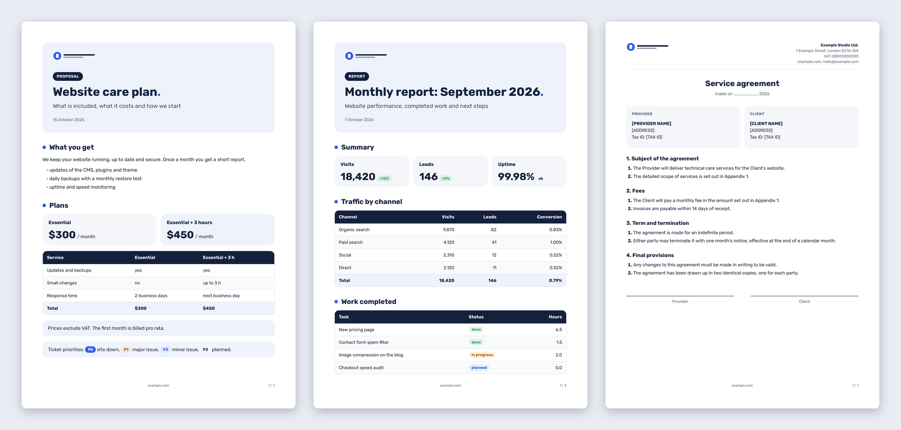

# letterhead

A skill for Claude Code (and other agents that read `SKILL.md`) that turns Markdown into PDFs on your company letterhead: logo, font, colors and legal details. Proposals, reports, contracts, letters and step-by-step guides come out with the same page layout, and before every PDF the agent asks which company the document is for.



## What you get

- **Five ready examples, four document types:** `document` (proposal, report), `contract`, `letter`, `guide` with screenshots.
- **Many companies in one skill:** each brand is a folder `brands/<slug>/` with `brand.yaml`, the logo and fonts. No code changes.
- **Building blocks:** tables with a highlighted total row, KPI cards, callouts, status pills, contract parties and signature lines, guide steps that never split across pages.
- **Consistent layout:** equal 16 mm margins, the logo on page one, logomark, domain and page number in the footer of the following pages.
- **Brand check:** `check` validates the brand (font files, color contrast, legal details for contracts).
- **Light and safe rendering:** no browser, no JavaScript, no network requests, images only from the document's folder.

## Requirements

- Python 3.10+ and `pip install pyyaml weasyprint` (WeasyPrint 70 or newer, no browser needed)
- WeasyPrint's system libraries: on macOS `brew install pango` (with the python.org Python also `export DYLD_FALLBACK_LIBRARY_PATH=/opt/homebrew/lib`), on Linux see the [WeasyPrint install guide](https://doc.courtbouillon.org/weasyprint/stable/first_steps.html)
- [pandoc](https://pandoc.org/installing.html)

## Install

```bash
git clone https://github.com/lukasz-slusarski/letterhead.git
ln -s "$PWD/letterhead/skills/letterhead" ~/.claude/skills/letterhead
```

## Use

Ask your agent: "make a PDF proposal for the client from these notes". Or run it yourself:

```bash
L=~/.claude/skills/letterhead/engine/letterhead.py
python3 $L brands                                 # available companies
python3 $L sample example -o /tmp/sample          # all examples in the example brand
python3 $L pdf proposal.md --brand example        # proposal.pdf next to the file
python3 $L new my-company                         # new brand from the template
python3 $L check my-company
```

Adding your own company: [BRANDS.md](skills/letterhead/BRANDS.md). The `example` brand is fictional; copy it or `_template`.

## License

Code: MIT. The Rubik font in the example brand: SIL Open Font License 1.1 (`brands/example/fonts/OFL.txt`).

Made by Łukasz Ślusarski, [important.is](https://important.is).
