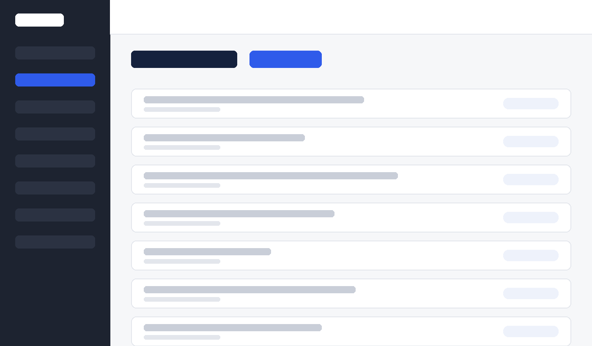

## Publishing a post

::: step
[1]{.num} In the admin panel click **Posts**, then **Add new**.

{width=420px}
:::

::: step
[2]{.num} Type the title and the content. Add an image with the **+** button inside the content.
:::

::: step
[3]{.num} On the right, choose a category and click **Publish**.
:::

::: {.callout .warn}
Upload images in landscape orientation, ideally 1600 px wide.
:::

A screenshot goes into a step as plain Markdown: ``. The path is relative to the .md file.
